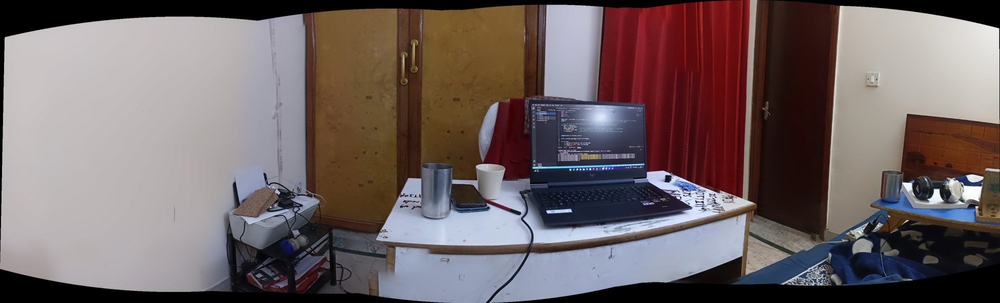
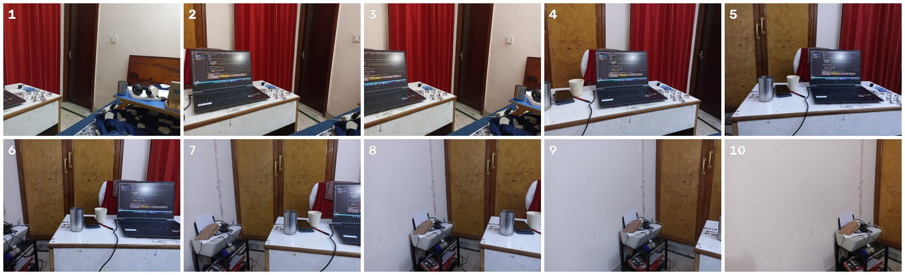

# Image Mosaicing: Panorama Stitching with OpenCV

Ten overlapping photos of one room go in, and one wide panorama comes out. A short Python script that uses OpenCV's
high-level `Stitcher` to find matching features between frames, align them, and blend them into one seamless image.



**Stack:** Python · OpenCV · NumPy

---

## Input

Ten handheld photos (1600 × 1201) taken while turning the camera across the room, each overlapping the one next to
it. They are in [`unstitchedImages/`](unstitchedImages).



## Output

[`stitchedOutput.png`](stitchedOutput.png): a single 3971 × 1204 panorama. The curved black edges are normal: the
stitcher projects all frames onto a cylinder-like surface before blending, and the corners it cannot fill stay
empty.

---

## How it works

`unstitchedImages/imagestitching.py`, step by step:

1. **Load** every `.jpg` in `unstitchedImages/` with `glob` and `cv2.imread`, showing each frame as it loads.
2. **Stitch** with `cv2.Stitcher_create()`. Inside, OpenCV:
   - detects keypoints in every image and computes descriptors,
   - matches keypoints between overlapping pairs and estimates the homography / camera rotation between them
     (RANSAC throws out bad matches),
   - runs bundle adjustment so all frames line up together, not just pair by pair,
   - warps the frames onto a common surface, finds seams and blends exposure so the joins don't show.
3. **Save** the result as `stitchedOutput.png` and display it. `stitch()` returns a status code first: if it is not
   `0` (for example, not enough overlap to match the frames) nothing is written.

## Run it

```bash
git clone https://github.com/codedchaitanya/uas-first-project.git
cd uas-first-project
pip install opencv-python numpy imutils
python unstitchedImages/imagestitching.py
```

Run it from the repository root, since the script looks for `unstitchedImages/*.jpg` relative to where you start
it. A window shows each input; press any key to step to the next one, and once more to close the panorama.

To stitch your own photos, put them in `unstitchedImages/` (JPG, roughly 30 to 50 % overlap between neighbours,
camera turned around one spot rather than walked sideways).

## Layout

```
uas-first-project/
├── unstitchedImages/
│   ├── imagestitching.py    the stitching script
│   └── *.jpg                10 input frames
├── stitchedOutput.png       result
└── docs/                    images for this README
```

---

**Chaitanya Roy** · [GitHub](https://github.com/codedchaitanya) ·
[LinkedIn](https://www.linkedin.com/in/chaitanya-roy-a8b756257/)
